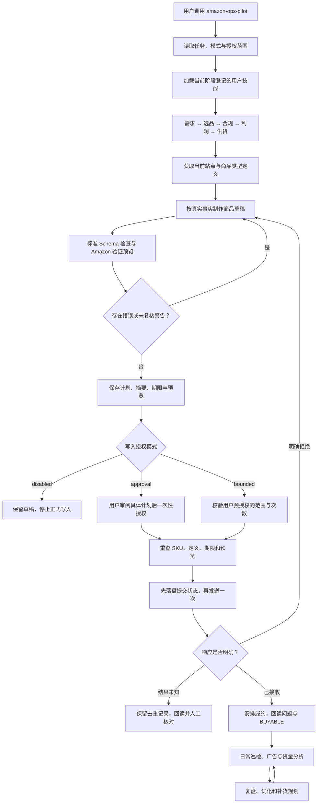

# Amazon Ops Pilot · 亚马逊运营领航

用一个运营主技能把亚马逊的工作串起来，再用 MCP 和官方 Selling Partner API 执行有范围、有记录的操作。

AI 运行在用户选择的 Agent 宿主中，负责理解资料、规划和生成草稿；本地 MCP 服务执行确定性的校验与接口请求，不内置大模型，也不要求额外填写模型服务密钥。

**主技能调用名：`$amazon-ops-pilot`。** 用户可以补充自己的品牌、选品、质检和复盘技能，由主技能按阶段加载。

> 当前版本 1.0.0。已经实现可运行的本地 MCP、单 SKU 新建 Listing 流程和模拟演示。真实店铺需自行取得 Amazon 应用及卖家授权。默认生产配置禁用正式提交；没有生产账号时的模拟测试不代表已通过 Amazon 生产认证。

## 能做什么

| 层 | 职责 |
| --- | --- |
| 运营主技能 | 控制需求、选品、合规、利润、供货、上架、履约、启动、日常运营和复盘 |
| 用户自定义技能 | 补充品牌语气、商品事实模板、利润策略、质检与复盘格式 |
| MCP | 验证输入、管理任务和证据、查询平台、预览商品、按授权提交并回读 |
| Amazon SP-API | 提供当前商品定义、处理请求、返回接收结果与后续问题 |

### 已实现的自动化

- 查询卖家参与站点、商品类型与动态 PTD 定义、指定 ASIN 目录和指定 SKU Listing。
- 查询 FBA 库存及允许类型的已有报表元数据，支持分页令牌。
- 校验标准 JSON Schema 2019-09，强制调用 Amazon `VALIDATION_PREVIEW`。
- 新 SKU 准备不可变发布计划、一次性授权或范围预授权、单次提交、回读可售与错误状态。
- 独占状态锁、计划摘要、期限、配置变化检测、价格/数量/类目/配送范围、日次数限制。
- 本地模拟闭环、单件贡献与补货计算、自定义技能读取。

### 流程覆盖与接口覆盖不同

主技能覆盖整体运营，但首版不自动操作广告投放、FBA 货件创建、买家消息、订单退款、认证/税务判断和已有 SKU 修改。它会说明需要人工完成什么、在哪个后台完成、凭什么回执继续。

SP-API 与 Advertising API 有不同接口和准入流程。不要把“已连接 SP-API”理解成已获得广告、全部报表、订单个人信息或所有类目销售权限。首版报表工具不创建或下载报告。

## 流程图



## 5 分钟本地演示

要求 Node.js 22.13+，建议使用当前 LTS。以下命令在仓库根目录执行：

```bash
npm ci
npm run check
npm run demo
```

演示使用 `examples/mock.config.json` 和 `examples/listing.demo.json`，所有数据均为本地模拟，不访问 Amazon、不创建真实商品。演示依次通过前置阶段、准备、提交、回读，最终进入 operations。每次生成不同的模拟 SKU。

启动模拟 MCP：

```bash
node --env-file-if-exists=.env dist/server.js
```

先将 `examples/mock.config.json` 复制为根目录的 `amazon-ops.config.json`。直接运行后等待输入是 stdio 服务的正常状态；应由 MCP 客户端连接，不会出现网页。

## 安装和调用主技能

在仓库根目录执行：

```bash
npm run skill:install
```

默认复制到当前用户 Codex 技能目录；如目标已存在则拒绝覆盖。也可明确给出其他支持 SKILL.md 的宿主目录：

```bash
npm run skill:install -- --destination /absolute/path/to/skills/amazon-ops-pilot
```

安装后在宿主加载技能，再调用：

```text
使用 $amazon-ops-pilot 为我的美国站新品建立运营任务。
先检查现有资料和阶段，列出缺失的商品事实与合规材料。
目前仅准备草稿和预览，不提交真实商品。
```

日常巡检：

```text
使用 $amazon-ops-pilot 检查这些 SKU 的可售状态和库存，
结合我提供的广告、销售及成本报告做周复盘，标出数据范围和人工待办。
```

有明确自动授权后：

```text
使用 $amazon-ops-pilot 继续当前上架任务。
在我已经配置的 bounded 授权范围内执行，不扩大范围；
提交后回读，分别报告平台接收、问题和可售状态。
```

## 接入 MCP 客户端

下面是常见 stdio 客户端的配置形状，字段放置方式请依宿主要求调整。把示例路径改为实际绝对路径，不能直接保留占位路径：

```json
{
  "mcpServers": {
    "amazon-ops-pilot": {
      "command": "node",
      "args": ["--env-file=/absolute/path/amazon-ops-pilot/.env", "/absolute/path/amazon-ops-pilot/dist/server.js"],
      "env": { "AMAZON_OPS_CONFIG": "/absolute/path/amazon-ops-pilot/amazon-ops.config.json" }
    }
  }
}
```

Windows 路径可以使用 `F:/path/amazon-ops-pilot/...`。凭据保存在本地 `.env` 或宿主秘密管理中，不应填入公共示例、Git、聊天记录或终端输出。全程仅通过 stdio 通信，不监听网络端口。

## 连接真实 Amazon 账号

1. 按 Amazon 当前准入要求创建/注册 SP-API 应用，并取得所需角色；Listing 操作需适用的 Product Listing 权限。
2. 自用应用按自授权流程处理；为其他卖家提供服务需按适用的公开应用授权、审核和数据要求处理。公开此 GitHub 仓库不等于应用获批。
3. 在本地准备 LWA client ID、client secret、卖家 refresh token，以及卖家 ID、目标 marketplace ID 和区域。
4. 将 `.env.example` 复制为 `.env`，`examples/live.config.json` 复制为 `amazon-ops.config.json`，填写真实值。
5. 保持 `writePolicy.mode` 为 disabled，先检查状态、站点参与、商品类型、目录和草稿验证。
6. 使用该卖家/站点/商品类型的动态定义制作真实正文。演示文件不是通用生产模板，DEMO_PRODUCT 不是真实类目。
7. 核实商品、品牌、图片、认证、费用和供货资料后，决定使用逐单授权或限范围自动授权。

认证通过 LWA 获取短期访问令牌并缓存；请求发送至配置区域的官方 SP-API 域名。不配置浏览器 Cookie，不通过模拟登录绕过准入。首版不请求买家受限个人数据。

完整步骤见 [部署说明](docs/部署说明.md) 和 [用户使用手册](docs/用户使用手册.md)。

## 两种发布授权

生产示例默认 **disabled**。以下两个模式都受站点、SKU 前缀、商品类型、币种、价格、数量、配送渠道、到期时间和日提交次数限制。

### approval：每个计划单独授权

先用 MCP 准备计划，再在仓库根目录查看精确正文：

```bash
npm run cli -- show-plan --plan PLAN_ID
npm run cli -- approve --plan PLAN_ID --by operator-name
```

由实际授权的操作者执行。授权绑定该计划及内容摘要，到期或正文变化后不能沿用；MCP 没有批准自己的工具。Agent 不能在没有用户授权时替自己运行 approve。

### bounded：在预设范围内自动执行

用户明确把 writePolicy.mode 设为 bounded，填写真实 authorizedBy、合理 expiresAt、次数与 scope。主技能可直接使用有效授权，不必每件重复询问。超范围时保留计划并请求相应范围，而不是改配置绕过。

默认的复核期、计划期限、次数和价格/数量限额是本项目护栏，可由操作者调整，**不是 Amazon 官方统一规则**。此版本只支持常规价格结构；促销、折扣或复杂报价需要扩展接口后另行验证。

## 自定义用户技能

创建 `custom-skills/brand-listing-style/SKILL.md`，内容可参考 [品牌文案技能示例](examples/custom-skills/brand-listing-style/SKILL.md)。然后登记到根目录配置：

```json
{
  "customSkills": [
    {
      "name": "brand-listing-style",
      "path": "custom-skills/brand-listing-style/SKILL.md",
      "stages": ["selection", "listing", "review"]
    }
  ]
}
```

**主技能已经明确约定：先读当前阶段登记项，再通过 MCP 读取并应用。** 子技能可以改变品牌风格、选品策略与报告格式，不能扩大接口权限、代替真实证明、跳过平台校验或自我批准发布。MCP 只读登记文件，不自动运行附带脚本。

路径相对配置文件所在目录，必须位于该目录内，目录联接/符号链接不能跳到外部。示例配置放在 examples 目录直接使用时，相对路径也以 examples 为准。更多见 [自定义技能扩展](docs/自定义技能扩展.md)。

## 正确理解成功、失败和恢复

- 平台 ACCEPTED：请求已接收，后续仍可能报错或不可售。
- BUYABLE：该次回读时对应站点可购买，不代表以后不会变化。
- unknown/submitting：保留记录并停止该 SKU 后续写入，人工核对；首版不自动恢复这类写入。
- 已存在 SKU：停止，避免 putListingsItem 的整体替换语义覆盖现有数据。检查与提交之间不存在平台级原子“仅创建”保证，仍应避免多人同时操作同一 SKU。
- 定义、配置或正文变化：重新准备计划，不沿用旧授权。

状态目录属于可信本机操作者。能够任意修改代码、配置或状态的主体也能改变规则；本项目不是多租户授权系统。不要把它直接暴露为没有额外认证的网络服务。

## 文档与开发

- [需求规格说明书](docs/需求规格说明书.md)
- [概要设计说明书](docs/概要设计说明书.md)
- [详细设计说明书](docs/详细设计说明书.md)
- [数据库设计文档](docs/数据库设计文档.md)
- [接口设计文档](docs/接口设计文档.md)
- [环境说明](docs/环境说明.md)
- [用户使用手册](docs/用户使用手册.md)
- [自定义技能扩展](docs/自定义技能扩展.md)
- [测试报告](docs/测试报告.md)
- [部署说明](docs/部署说明.md)
- [更新日志](docs/更新日志.md)
- [项目总结](docs/项目总结.md)

开发检查在仓库根目录执行 `npm run check`。测试包含真实 stdio 子进程协议测试及模拟 HTTP 合约测试；不需要 Amazon 凭据，不会调用生产平台。依赖锁定在 package-lock.json。

## 官方依据

规则和技术依据按 2026-11-14 核对；执行时仍需按站点、类目和卖家权限重新确认。

- [连接 SP-API 与 LWA](https://developer-docs.amazon/sp-api/docs/connecting-to-the-selling-partner-api)
- [动态商品类型定义](https://developer-docs.amazon/sp-api/docs/product-type-definitions-api)
- [验证预览](https://developer-docs.amazon/sp-api/docs/preview-errors-before-creating-a-listing)
- [Listing 生命周期](https://developer-docs.amazon/sp-api/docs/building-listings-management-workflows-guide)
- [putListingsItem 的创建与整项更新语义](https://developer-docs.amazon/sp-api/reference/putlistingsitem)
- [商品详情页规则](https://sellercentral.amazon.com/help/hub/reference/external/G200390640)
- [MCP 官方 TypeScript SDK](https://github.com/modelcontextprotocol/typescript-sdk)

维护备注：maorongkang@gmail.com。
