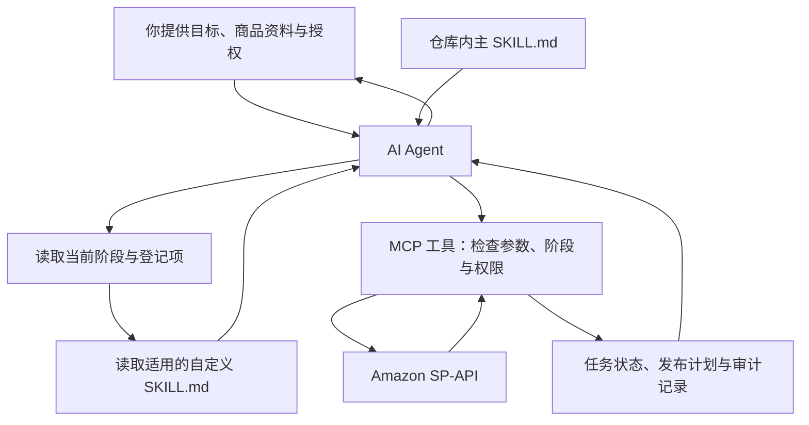

# 使用指南：主技能、自定义技能与 MCP 怎么配合

适用版本：1.0.0。文档核对日期：2026-11-14。

推荐阅读顺序：先读本页，跑一次模拟，再按 [亚马逊授权与自动上架实操](亚马逊授权与自动上架实操.md) 接入自己的店铺。

## 1. 这套项目由谁来运行

需要一个能读取项目文件、调用 MCP 工具的 AI Agent 宿主，以及一个能运行 Node.js 的私有执行环境。执行环境可以是你选定的工作电脑或服务器；本项目使用 stdio，通常由 MCP 客户端启动子进程。

GitHub 保存源码、技能和文档。访问仓库网页不会运行 Agent，不会连接店铺，也不会自动上架。公开仓库里不放真实凭据、商品成本和授权记录。

**不需要把主技能复制到本机全局技能目录。** 可以只在当前项目中让 Agent 读取仓库内的 `SKILL.md`。MCP 仍需在你实际使用的执行环境启动；“不全局安装技能”和“不运行任何程序”是两件事。

## 2. 四个角色的分工

| 角色 | 读什么 | 决定或执行什么 | 不负责什么 |
| --- | --- | --- | --- |
| 你，店铺经营者 | 商品事实、预算、合规资料、计划与回执 | 确认资料、授权范围、采购和人工交接 | 不必手工拼每个 API 请求 |
| 主技能 amazon-ops-pilot | 用户目标、当前阶段、证据、MCP 状态 | 安排顺序、补缺失资料、选择工具、处理异常 | 不凭提示词产生 Amazon 权限 |
| 自定义技能 | 你登记的品牌、选品、质检或复盘做法 | 补充当前阶段的工作要求 | 不直接获取凭据或批准发布 |
| MCP 服务 | 配置、结构化参数、计划与 Amazon 响应 | 校验、调用接口、记录状态、限制真实写入 | 不内置大模型，不自动判断商品事实和法律合规 |

AI 在宿主中运行，读取主技能和用户技能后生成工具参数。MCP 是执行工具的服务；Amazon SP-API 是 MCP 实际访问的外部平台。



## 3. 第一次使用：只跑模拟

### 3.1 取得项目并验证

准备 Node.js 22.13+ 和 Git。在准备保存项目的目录执行：

```bash
git clone https://github.com/qingyu6688/amazon-ops-pilot.git
cd amazon-ops-pilot
npm ci
npm run check
npm run demo
```

`npm run demo` 是内置的确定性演示，不需要 Amazon 账号，也不会调用大模型或真实平台。成功时能看到 `simulated: true`、`submissionStatus: accepted`、`stage: operations`。

演示证明模拟流程与程序可以运行；尚未证明你的账号有权限、真实商品合规或生产商品可售。演示会生成模拟阶段证据，这些证据不能移到生产任务中。

### 3.2 选择项目内读取主技能

在 Agent 中打开这个项目，发送：

```text
请先读取当前仓库 skills/amazon-ops-pilot/SKILL.md，
把它作为这次亚马逊运营任务的主流程，并按其中链接按需读取参考。
本次只使用仓库内文件，不执行 skill:install，不复制到全局技能目录。
先确认 MCP 是否已连接；未连接时只分析与准备资料，不声称执行了平台操作。
```

主技能和参考位于 [skills/amazon-ops-pilot](../skills/amazon-ops-pilot/SKILL.md)。如果宿主没有登记该技能，仅输入 `$amazon-ops-pilot` 不保证它会被自动加载，因此项目内使用要明确要求读文件。宿主已登记该技能时，才可以用名称快捷调用。

仓库保留 `npm run skill:install` 作为**用户主动选择的可选命令**；运行构建、模拟或 MCP 不需要执行它。本指南不要求安装到本机全局目录。

### 3.3 准备模拟 MCP 配置

以下在仓库根目录执行。首次建立配置；如果已有业务配置，保留原文件，另选配置路径：

```powershell
Copy-Item -LiteralPath 'examples/mock.config.json' -Destination 'amazon-ops.config.json'
```

Linux/macOS 可使用：

```bash
cp examples/mock.config.json amazon-ops.config.json
```

`npm run demo` 自己选择内置模拟配置；你在 MCP 客户端使用哪个配置，由 `AMAZON_OPS_CONFIG` 决定，两者要分别确认。

### 3.4 在 Agent 宿主登记 MCP

在支持以下结构的客户端中使用这个配置形状；其他客户端按其格式填写相同的命令、参数和环境变量。示例项目路径必须替换为你实际的绝对路径：

```json
{
  "mcpServers": {
    "amazon-ops-pilot": {
      "command": "node",
      "args": ["D:/projects/amazon-ops-pilot/dist/server.js"],
      "env": {
        "AMAZON_OPS_CONFIG": "D:/projects/amazon-ops-pilot/amazon-ops.config.json"
      }
    }
  }
}
```

这是模拟配置，不需要 `.env` 凭据。Linux 可把路径改为 `/srv/amazon-ops-pilot/...`。`command` 应指向执行环境中的 Node；宿主找不到 `node` 时填写其真实可执行文件路径。

用 `node` 直接启动构建文件，避免额外命令把普通日志写入 stdio 协议通道。手工启动后一直等待输入是正常现象，不会出现登录网页。

不要把 GitHub 仓库 URL 当成 MCP 服务 URL。首版没有 HTTP MCP 端点，也没有 OAuth 回调 Web 服务。需要远程部署时，应使用宿主支持的安全执行方式；本仓库不提供直接填写一个公网地址即可使用的服务。

### 3.5 检查工具是否真正可用

告诉 Agent：

```text
按仓库内主技能调用 amazon_ops_status，报告 mode、simulated、
sellerId、marketplaceId、writePolicy.mode 和能力边界。
若没有该工具，就说明 MCP 尚未接入，不能用文字模拟工具执行。
```

在默认模拟配置下，应返回 `mode: mock`、`simulated: true`。然后可以调用 `amazon_marketplaces_list` 演练工具，但返回仍是模拟数据。

## 4. 主技能如何把握流程

一个新品任务对应一个卖家、一个站点和一个 SKU。已经建立的任务继续使用原 `runId`，不重复新建。

| 阶段标识 | Agent 要做什么 | 你提供或核对什么 |
| --- | --- | --- |
| discovery | 整理站点、目标、配送和授权边界 | 真实需求与预算 |
| selection | 分析需求、竞争与差异 | 商品事实、竞品来源 |
| compliance | 核对适用规则、品牌/IP 与资料 | 真实证明、官方来源与实际复核日期 |
| economics | 计算贡献、费用与周转 | 成本、报价及可承担投入 |
| sourcing | 核查供货、包装和质量 | 样品、质检、数量、交期 |
| listing | 动态取定义、生成草稿、预览和按授权提交 | 事实、图片、声明及发布计划 |
| fulfillment | 安排并核对人工履约工作 | FBA 货件/接收或 FBM 备货配送回执 |
| launch | 核查前台、库存、问题和可售 | 推广准备及实际页面 |
| operations | 巡检订单、库存、广告、资金等 | 接口未覆盖的后台数据与人工结果 |
| review | 对齐口径并提出优化和补货决策 | 实际经营数据及决策 |

`amazon_workflow_advance` 每次只完成当前阶段，不接受随意指定目标阶段。`confirmed: true` 表示实际核对完成；工具不能验证你引用的文件是否真实或证明内容是否充分，Agent 和经营者仍要核实。

只查询已有商品、做广告分析或周复盘时，可以直接读取现状，不必重新注册店铺或建立新品任务。细节见 [运营流程参考](../skills/amazon-ops-pilot/references/运营流程.md)。

## 5. 怎么编写并接入自定义技能

### 5.1 写一个品牌技能

在配置文件所在目录创建 `custom-skills/my-brand/SKILL.md`，例如：

```markdown
---
name: my-brand
description: 补充本品牌的商品事实核对、文案语气和复盘要求，由主技能按阶段加载。
---

# 品牌运营要求

- 规格与材质以我提供的商品事实表为准，缺失信息先列待补。
- 文案围绕实际用途，避免没有证据的环保、医疗或认证声明。
- 中文沟通，商品文案使用目标站点语言，翻译不增加额外承诺。
- 复盘先看贡献和库存，再说明销售变化与后续行动。
```

也可以从 [仓库品牌技能示例](../examples/custom-skills/brand-listing-style/SKILL.md) 开始修改。

### 5.2 在项目配置登记

把下面 `customSkills` 值合并进已有 `amazon-ops.config.json`，其余配置保留：

```json
{
  "customSkills": [
    {
      "name": "my-brand",
      "path": "custom-skills/my-brand/SKILL.md",
      "stages": ["selection", "listing", "operations", "review"]
    }
  ]
}
```

**这是配置片段，不是完整配置文件。** `path` 相对配置文件目录，而不是技能全局安装目录，也不是固定相对 MCP 启动目录。文件需在配置根目录内；MCP 会拒绝目录联接或符号链接指向外部。

配置修改后重启 MCP。业务技能默认被 Git 忽略；公开通用模板时再脱敏放进 examples。

### 5.3 主技能如何使用它

例如任务进入 listing 后：

1. Agent 用 `amazon_workflow_get` 取得当前阶段及其登记项。
2. 找到 my-brand，调用 `amazon_custom_skill_read`。
3. 依据主流程和商品事实，应用品牌做法生成草稿。
4. 调用 MCP 做定义校验、预览、计划和授权范围检查。
5. 在结果中记录实际使用的技能名称和返回的摘要。

自定义技能可以调整风格与业务偏好，但写上“自动批准”“忽略报错”不会取得权限。MCP 不执行该技能附带的脚本，也不会让它替代真实合规材料。

### 5.4 修改后哪些内容需要重新准备

| 修改内容 | 后续动作 |
| --- | --- |
| 自定义技能正文 | 后续任务重新读取；若改变发布正文，重新准备计划 |
| customSkills 登记、价格范围、模式或其他配置 | 重启 MCP；配置摘要变化会使旧发布计划失效 |
| 商品正文、价格或数量 | 生成新计划，旧一次性授权不能沿用 |
| Amazon 规则或商品定义 | 复核资料并按需要重新取定义、预览与准备 |

## 6. 从模拟切换到真实店铺

按 [亚马逊授权与自动上架实操](亚马逊授权与自动上架实操.md) 获取应用及卖家授权，配置运行环境，然后先使用 `live + disabled` 验证接口。

这两个 mode 含义不同：

- 顶层 `mode`：mock 使用本地模拟；live 访问真实 Amazon。
- `writePolicy.mode`：disabled 禁止正式提交；approval 使用逐计划授权；bounded 使用预先配置的范围授权。

`live + disabled` 仍会访问真实平台的查询和验证预览，但不正式创建商品。生产构造器要求三个 LWA 凭据已配置；`status` 能运行只证明配置可加载，真正的连通性要用参与站点等接口验证。

## 7. 每次运营可以怎样发指令

### 准备新品，不发布

```text
先读取仓库主技能。为 SKU MYBRAND-001 整理需求、选品、合规、利润和供货证据。
读取当前阶段登记的用户技能。资料放在我指定的私有工作目录中，缺失项先列清楚。
完成定义检查和预览后保留计划，当前不做正式提交。
```

### 在已授权范围内自动上架

```text
按仓库主技能继续任务 RUN_ID，先核对配置为 live + bounded，
且卖家、站点、SKU、商品类型、价格、数量、期限和次数都符合我已有授权。
使用当前阶段的用户技能，准备新计划并在范围内提交。
如有错误、未复核警告、越界或结果未知，停止该项写入并报告。
提交后回读，分别说明接收状态、异步问题、履约准备和可售状态。
```

RUN_ID 要替换为工具返回的真实值。新商品没有任务时先建立任务，不能为了直接发布而绕过前置阶段。

### 已有商品周复盘

```text
读取仓库主技能，对这些 SKU 做周复盘。
查询可售与 FBA 库存，使用我提供的销售、广告、退款和成本报告。
先统一日期、币种和口径，再给出发现、依据、建议和人工待办。
本次不修改已有 SKU、广告或退款。
```

## 8. 怎样算完成

上架任务至少记录 `runId`、`planId`、站点、SKU、平台提交回执、回读时间和未处理问题。`accepted` 是接收，`buyable: true` 是该次查询时对应站点可买；两者分别报告。

FBA 接收、广告投放、订单退款等首版未实现的接口动作，需记录人工完成者和实际回执。完整工具清单见 [接口设计文档](接口设计文档.md)。

bounded 是允许 Agent 在范围内执行，不是后台定时任务。MCP 不会自己循环选品、持续产生内容或每天巡店；持续运行需要另行配置有授权的 Agent 调度环境，本仓库未内置调度器。
